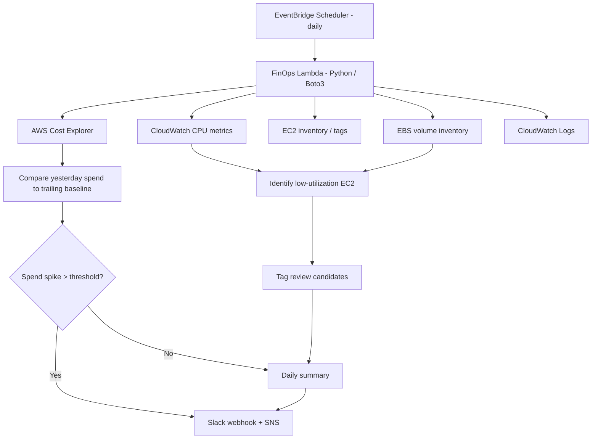

# AWS FinOps Automation: Cost Anomaly Detector

A serverless FinOps reference project that checks AWS spend daily, detects material cost spikes, sends Slack/SNS alerts, and inventories idle EC2 instances and unattached EBS volumes.

## What it does

- EventBridge Scheduler invokes a Python AWS Lambda once per day.
- Lambda queries AWS Cost Explorer for yesterday's unblended cost and compares it with a configurable trailing daily baseline.
- A cost spike above the configured threshold (default 20%) generates a Slack alert and SNS notification.
- CloudWatch metrics are queried to identify EC2 instances with low average CPU over a lookback window.
- Unattached EBS volumes and idle EC2 instances are tagged for review, and right-sizing recommendations are included in the report.
- All resource mutation is **safe-by-default**: no EC2 instance is stopped, resized, or EBS volume deleted. The project tags candidates and reports recommendations. Optional automated EC2 stop is intentionally not implemented because CPU alone is not sufficient evidence that an instance is safe to stop.

## Architecture

See [`docs/architecture.svg`](docs/architecture.svg) for the rendered architecture and [`docs/architecture.mmd`](docs/architecture.mmd) for editable Mermaid source.



## Repository structure

- `lambda/handler.py` – cost analysis, utilization analysis, tagging, alerting.
- `terraform/` – IAM, Lambda, EventBridge Scheduler, SNS, CloudWatch log group, and SSM parameter.
- `scripts/` – local invocation and sample Slack payload.
- `docs/` – architecture diagrams and evidence template.
- `.github/workflows/` – Python tests and lint workflow.

## Prerequisites

- AWS account with Cost Explorer enabled.
- Terraform >= 1.6 and AWS CLI v2.
- Slack incoming webhook URL (optional; SNS still works without Slack).
- Permissions to create Lambda, IAM, EventBridge Scheduler, SNS, SSM Parameter Store, and CloudWatch resources.

**Cost Explorer note:** Cost Explorer data can lag and is not real-time. The Lambda checks completed daily periods and uses unblended cost by default. The first day or two may have incomplete baseline data.

## Deploy

1. Copy the example variables file:

   ```bash
   cd terraform
   cp terraform.tfvars.example terraform.tfvars
   ```

2. Set `aws_region`, `notification_email`, and the SSM parameter name. Cost Explorer is a global billing service; the SDK call is routed to `us-east-1` by default using `COST_EXPLORER_REGION`. EC2/EBS inventory and CloudWatch utilization discovery run in the configured `aws_region`; deploy one stack per workload region (with a separate state/workspace) if you want regional resource coverage across multiple regions.

3. If using Slack, create a SecureString SSM parameter containing the webhook URL. Do not commit the URL to Git:

   ```bash
   aws ssm put-parameter \
     --name /finops/slack-webhook \
     --type SecureString \
     --value 'https://hooks.slack.com/services/REPLACE/ME' \
     --overwrite \
     --region ap-south-1
   ```

   Use a customer-managed KMS key and scope the Lambda role to decrypt only this parameter if your security requirements need it.

4. Initialize and review:

   ```bash
   terraform init
   terraform fmt -recursive
   terraform validate
   terraform plan
   terraform apply
   ```

5. Confirm the EventBridge Scheduler schedule and Lambda logs. Trigger a manual test:

   ```bash
   aws lambda invoke \
     --function-name aws-finops-cost-anomaly-detector \
     --payload '{}' \
     response.json
   cat response.json
   ```

The Lambda role includes Cost Explorer read access, EC2 describe/tag permissions, CloudWatch metric read access, SNS publish, and SSM parameter read. Review and narrow permissions for your environment.

## Detection logic

- **Current period:** yesterday, in UTC.
- **Baseline:** average daily unblended cost across the preceding 7 completed days.
- **Anomaly:** yesterday's spend is greater than baseline × (1 + `ANOMALY_THRESHOLD`, default `0.20`).
- If the baseline is zero or no usable data exists, the anomaly percentage is reported as unavailable instead of dividing by zero.
- Cost Explorer may revise recent data; alerts should be treated as operational signals, not invoices.

## Idle resource logic

- EC2 candidates are instances in `running` state with average `CPUUtilization` below `IDLE_CPU_THRESHOLD` (default 5%) over `IDLE_LOOKBACK_DAYS` (default 7).
- EBS candidates are volumes with state `available` (unattached).
- Candidates are tagged with `FinOpsReview=IdleCandidate` and a UTC review timestamp. The Lambda does not delete volumes, stop instances, or change instance types.
- The report provides conservative right-sizing review hints. CPU alone does not capture memory, disk, network, scheduled jobs, or business criticality.

## Slack alert example

A sample message is in [`docs/slack-alert-sample.json`](docs/slack-alert-sample.json). The Lambda sends a Slack Block Kit message containing:
- Yesterday's spend and baseline
- Percentage change and threshold
- Idle EC2 candidates
- Unattached EBS volumes
- A reminder that changes are recommendations and review is required

## Before/after cost comparison

Do not invent savings. Populate [`docs/cost-comparison-template.csv`](docs/cost-comparison-template.csv) after collecting at least one baseline period and one post-remediation period. Compare like-for-like date ranges and account for workload changes.

Example format:

| Metric | Before | After |
|---|---:|---:|
| Monthly AWS spend | measured value | measured value |
| Idle EC2 instances | measured count | measured count |
| Unattached EBS volumes | measured count | measured count |
| Estimated monthly savings | calculated | calculated |

## Resume bullet – evidence-based wording

Before measuring actual savings:

> Built serverless FinOps automation using AWS Lambda, EventBridge, Cost Explorer, CloudWatch, Boto3, SNS, and Slack to detect daily spend anomalies and identify idle EC2/EBS resources for cost optimization.

After validating a measured result, add the actual percentage and measurement window. Do not claim a 20% reduction until the before/after data supports it.

## Safety and production hardening

- Start with read-only observation and review tags; do not enable destructive automation without explicit owner approval.
- Add account/region allowlists, resource exclusion tags, maintenance windows, and change approvals before any automated stop/resize workflow.
- Add CloudWatch alarms for Lambda errors, throttles, and missed schedules.
- Consider AWS Budgets and Cost Anomaly Detection as complementary managed services.
- Cost Explorer API calls may incur charges depending on current AWS pricing and usage; check current pricing.
- Protect Slack webhooks as secrets and rotate them if exposed.
